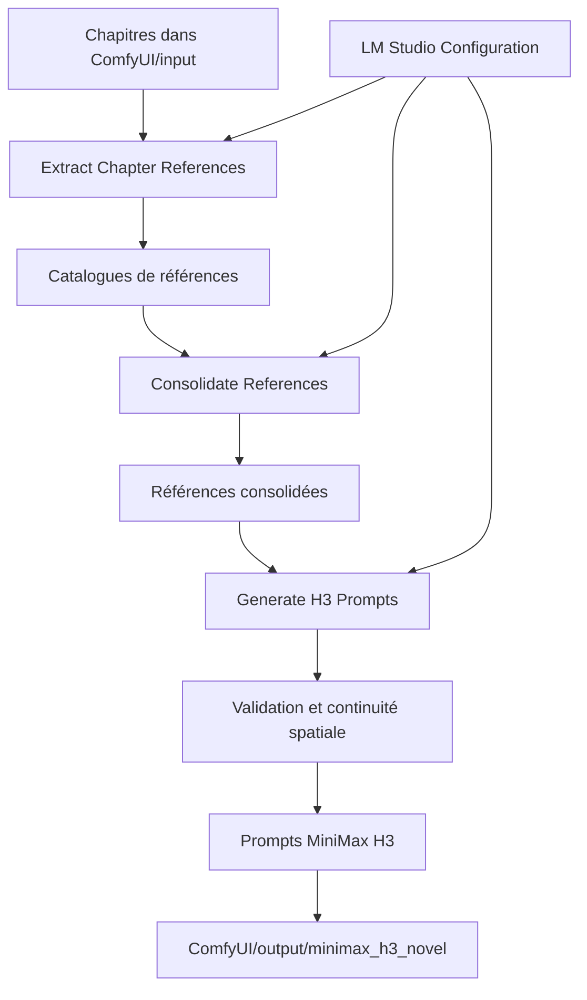

# Architecture

## Schéma du pipeline

Le pipeline lit les chapitres, extrait les personnages, lieux et objets, consolide les références, puis génère les prompts MiniMax H3. Les nodes de chargement permettent de reprendre les résultats sauvegardés.

## Custom nodes

| Custom node | Description |
|---|---|
| `ComfyUI-CustomNodesManager` | Installation et gestion des extensions ComfyUI. |
| `ComfyUI-CustomTemplate` | Templates et workflows personnalisés. |
| `ComfyUI-Enhancement-Utils` | Utilitaires de traitement et d’amélioration d’images. |
| `ComfyUI-Florence2` | Description et compréhension d’images avec Florence-2. |
| `ComfyUI-GGUF` | Chargement de modèles au format GGUF. |
| `ComfyUI-KJNodes` | Nodes utilitaires pour les workflows. |
| `comfyui-lmstudio-prompt-enhancer` | Amélioration de prompts via LM Studio. |
| `ComfyUI-Minimax_H3_Novel_Pipeline` | Extraction de références et génération de prompts MiniMax H3. |
| `ComfyUI-MiniMax-H3-Prompt-Enhancer` | Enrichissement de prompts MiniMax H3. |
| `ComfyUI-MiniMax-H3-Promptor` | Préparation de prompts et paramètres H3. |
| `ComfyUI-OpenAI-Api` | Connexion à une API compatible OpenAI. |
| `ComfyUI-QwenVL-Mod` | Analyse multimodale avec Qwen-VL. |
| `ComfyUI-Z-Engineer` | Assistance à la génération de prompts Z-Image. |

## Nodes MiniMax H3 Novel

- **LM Studio Configuration** : configure le serveur local et le modèle texte.
- **Extract Chapter References** : extrait les entités et observations des chapitres.
- **Consolidate References** : regroupe les références et prépare les designs.
- **Generate H3 Prompts** : génère et contrôle les prompts vidéo.
- **Load ...** : recharge les résultats d’une exécution précédente.

## Référence détaillée

Le schéma interne des modules Python est conservé dans [`ComfyUI-Minimax_H3_Novel_Pipeline/docs/architecture.md`](ComfyUI/custom_nodes/ComfyUI-Minimax_H3_Novel_Pipeline/docs/architecture.md).
