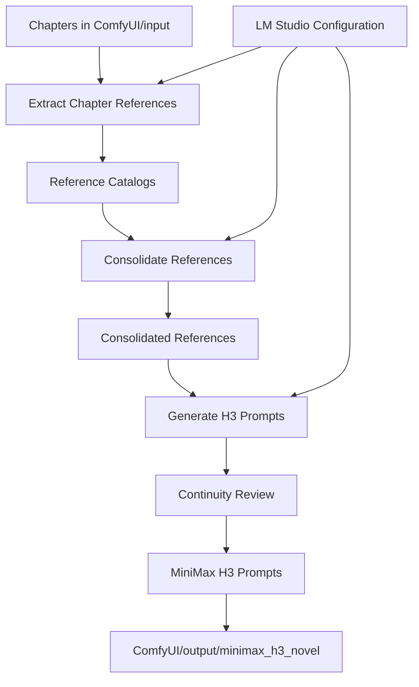

# ComfyUI Setup Repository

Local Windows setup for ComfyUI, NVIDIA acceleration, custom nodes, and the MiniMax H3 Novel pipeline.

## Installation

### Base environment

```powershell
cd E:\AI\ComfyUI
python -m venv .venv
. .\.venv\Scripts\Activate.ps1
pip install --upgrade pip
pip install torch torchvision torchaudio --extra-index-url https://download.pytorch.org/whl/cu129
pip install -r .\requirements.txt
python .\main.py
```

Custom-node installers are in [`Scripts/CustomNodes/`](Scripts/CustomNodes/). Place models in the matching `ComfyUI/models/` folders.

### LM Studio

LM Studio provides the local OpenAI-compatible text and JSON API used by the MiniMax H3 Novel nodes. It does not run ComfyUI video models. Start its local server, load a text model, then use the same endpoint in ComfyUI.

- **Server URL:** `http://127.0.0.1:1234/v1`
- **Model:** the model loaded in LM Studio, such as Qwen or Mistral
- **API key:** leave empty unless the server requires one
- **Trusted API URL:** add the server URL in ComfyUI settings
- **Connection:** connect **LM Studio Configuration** to the MiniMax H3 Novel nodes

## Architecture

The pipeline extracts chapter references, consolidates them, and creates MiniMax H3 prompts. Detailed node internals are documented in [`ComfyUI-Minimax_H3_Novel_Pipeline/docs/architecture.md`](ComfyUI/custom_nodes/ComfyUI-Minimax_H3_Novel_Pipeline/docs/architecture.md).



### Custom nodes

| Custom node | Description |
|---|---|
| `ComfyUI-CustomNodesManager` | Installs and manages ComfyUI extensions. |
| `ComfyUI-CustomTemplate` | Provides custom templates. |
| `ComfyUI-Enhancement-Utils` | Image-processing utility nodes. |
| `ComfyUI-Florence2` | Image description and understanding with Florence-2. |
| `ComfyUI-GGUF` | Loads GGUF models. |
| `ComfyUI-KJNodes` | General-purpose utility nodes. |
| `comfyui-lmstudio-prompt-enhancer` | Enhances prompts through LM Studio. |
| `ComfyUI-Minimax_H3_Novel_Pipeline` | Extracts references and generates MiniMax H3 prompts. |
| `ComfyUI-MiniMax-H3-Prompt-Enhancer` | Enhances MiniMax H3 prompts. |
| `ComfyUI-MiniMax-H3-Promptor` | Prepares MiniMax H3 prompts and parameters. |
| `ComfyUI-OpenAI-Api` | Connects to OpenAI-compatible APIs. |
| `ComfyUI-QwenVL-Mod` | Performs multimodal analysis with Qwen-VL. |
| `ComfyUI-Z-Engineer` | Assists with Z-Image prompt creation. |

## Repository layout

- [`ComfyUI/`](ComfyUI/): ComfyUI, custom nodes, models, and outputs.
- [`Scripts/`](Scripts/): PowerShell setup and maintenance scripts.
- [`Sources/`](Sources/): input images and resources.
- [`software/`](software/): supporting components.
- [`Howto.md`](Howto.md): setup notes.

Pipeline output is written to `ComfyUI/output/minimax_h3_novel/`.
